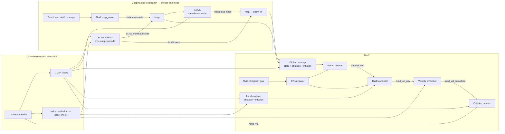

# Autonomous TurtleBot3 Navigation & Dynamic Obstacle Avoidance

   

This ROS 2 Jazzy package runs a simulated TurtleBot3 Waffle in Gazebo
Harmonic. Nav2 provides path planning, local control, costmaps, localization,
and dynamic obstacle avoidance. Use a saved occupancy map with AMCL or map an
environment live with SLAM Toolbox.

## Video demonstration

[](https://youtu.be/YgTTjvmDnQk)

▶️ [Watch the video demonstration on YouTube](https://youtu.be/YgTTjvmDnQk)

## Detailed learning and implementation report

📘 [Read the detailed learning and implementation report on Overleaf](https://www.overleaf.com/project/6ae61a7b594dce22ead15141/share#a7477c91721805a48bb192bf671cb207952dc0ddcb81a49c)

## System architecture



- **Localization and mapping:** AMCL localizes against a saved map; SLAM
  Toolbox creates a live map.
- **Obstacle handling:** Nav2 costmaps integrate static map data and LiDAR
  observations; the collision monitor can stop the robot when an obstacle is
  too close.
- **Navigation:** NavFn plans a global path and DWB selects local velocity
  commands for the simulated Waffle.

## Environment

| Layer | Configuration |
|---|---|
| Host | HP EliteBook 840 G5, Intel Core i7-8650U, 24 GB RAM |
| Operating system | Ubuntu 24.04 LTS on WSL2 with WSLg |
| Middleware | ROS 2 Jazzy Jalisco |
| Simulator | Gazebo Harmonic through `ros_gz`, with RViz2 |
| Navigation | Nav2 with `nav2_bringup` and `nav2_minimal_tb3_sim`; package launch wrapper |
| Robot | Simulated TurtleBot3 Waffle with LiDAR; configured costmap radius is 0.22 m |

## Requirements

- Ubuntu 24.04 with ROS 2 Jazzy
- Nav2 and Gazebo integration
- A colcon workspace

Install the main ROS packages:

```bash
sudo apt update
sudo apt install -y \
  ros-jazzy-navigation2 \
  ros-jazzy-nav2-bringup \
  ros-jazzy-ros-gz \
  python3-rosdep
```

Initialize rosdep once per machine if it has not already been initialized:

```bash
sudo rosdep init
rosdep update
```

From the workspace root, install the package's remaining declared ROS
dependencies:

```bash
rosdep install --from-paths src --ignore-src -r -y
```

The launch file sets `TURTLEBOT3_MODEL=waffle` itself.

## Build

From the workspace root:

```bash
colcon build --packages-select antropi_tb3_nav --symlink-install
source install/setup.bash
```

Source the workspace in each new terminal before using the package.

## Run the simulation

Start the default Nav2 TurtleBot3 sandbox world and its stock map:

```bash
ros2 launch antropi_tb3_nav navigation.launch.py
```

In RViz, select **Nav2 Goal**, then click and drag on a free part of the map.
Nav2 plans and drives the simulated robot while the costmaps and collision
monitor respond to LiDAR obstacles.

### Custom maze

Load the package's Gazebo maze and matching static map together:

```bash
ros2 launch antropi_tb3_nav navigation.launch.py use_custom_maze:=true
```

To load the maze map while keeping the default sandbox world instead:

```bash
ros2 launch antropi_tb3_nav navigation.launch.py use_custom_map:=true
```

The custom map and stock world may not have matching geometry. Use
`use_custom_maze:=true` when you want the maze environment.

### SLAM mapping

Enable live mapping in the custom maze:

```bash
ros2 launch antropi_tb3_nav navigation.launch.py \
  use_custom_maze:=true slam:=true
```

SLAM mode uses live mapping/localization instead of the selected saved map and
AMCL. To run Gazebo without its graphical client, add `headless:=true`.

The launch arguments are `use_custom_maze`, `use_custom_map`, `slam`,
`headless`, `x_pose`, `y_pose`, `z_pose`, and `yaw`. Boolean arguments should
be written lowercase as `true` or `false`. The default custom-maze spawn is
`x=-0.075`, `y=-1.975`, `z=0.01`, `yaw=1.5708`. If you change the spawn while
using AMCL, update the `initial_pose` in `config/nav2_params.yaml` to match.

## Exploration nodes

Explorers are separate ROS nodes; they are not started by the launch file.
First start simulation with SLAM, then run one explorer in another sourced
terminal:

```bash
ros2 launch antropi_tb3_nav navigation.launch.py \
  use_custom_maze:=true slam:=true
```

Choose one:

```bash
ros2 run antropi_tb3_nav smart_explorer --ros-args -p use_sim_time:=true
```

or:

```bash
ros2 run antropi_tb3_nav topological_coverage_explorer \
  --ros-args -p use_sim_time:=true
```

Both use `/map`, `/scan`, robot TF, and Nav2's `navigate_to_pose` action.
See the [explorer comparison](antropi_tb3_nav/explorers/EXPLORER_COMPARISON.md)
and the individual strategy guides for details. Run only one explorer at a
time.

## Save and regenerate the maze map

After SLAM exploration, save the resulting map from the workspace root:

```bash
ros2 run nav2_map_server map_saver_cli -f maps/maze_map
```

To regenerate the source map and matching Gazebo wall model, the generation
scripts require NumPy, Pillow, and SciPy; rasterizing the GLB also requires
`trimesh`:

```bash
python3 maps/make_maze_map.py \
  models/maze/meshes/maze.glb --out maps/maze_map_source
python3 maps/generate_maze_world.py
```

The first command rasterizes the maze and widens thin walls. The second uses
the source raster to write `maps/maze_map.yaml`, its PGM, a preview, and
`models/maze/model.sdf`. These generated assets are used by custom-maze mode.

## Dynamic obstacle demonstration

While the robot is navigating, insert a movable box obstacle into the
Gazebo world:

```bash
ros2 run ros_gz_sim create \
  -name dynamic_block \
  -string '<sdf version="1.6"><model name="dynamic_block"><static>false</static><link name="link"><visual name="v"><geometry><box><size>0.35 0.35 0.4</size></box></geometry><material><ambient>1 0 0 1</ambient><diffuse>1 0 0 1</diffuse></material></visual><collision name="c"><geometry><box><size>0.35 0.35 0.4</size></box></geometry></collision></link></model></sdf>' \
  -x 0.0 -y -0.2 -z 0.2
```

## License

This project is licensed under the [Apache License 2.0](LICENSE).
